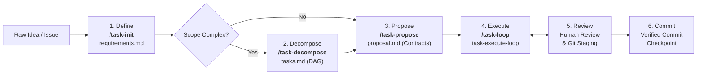

# PDCE Framework: Proposal-Driven Controlled Execution

> **Think by Design. Execute by Delegation.**  
> A developer-led methodology for structured, reviewable AI-assisted software development.

```text
Define ───► Decompose ───► Propose ───► Execute ───► Review ───► Commit
```

---

## 📌 What is PDCE?

**PDCE** (**P**roposal-**D**riven **C**ontrolled **E**xecution) is an engineering framework designed to eliminate the **coding bottleneck** without conceding architectural control or planning to autonomous AI agents.

### Why PDCE Fits
- **Proposal-Driven**: Implementation starts only after a comprehensive, developer-reviewed technical proposal is approved.
- **Controlled**: The AI operates strictly within human-approved contracts, scopes, and test boundaries.
- **Execution**: The agent's focus is on getting mechanical implementation done at high velocity, rather than automating architectural decisions.

### Core Terminology
- **Methodology**: `PDCE`
- **Full Name**: `Proposal-Driven Controlled Execution`
- **Framework**: `PDCE Framework`
- **Development Approach**: `PDCE Development`

---

## 💡 Core Philosophy

Most AI coding tools attempt to automate both **thinking** and **execution**, which often leads to hallucinated architectures, unvetted dependencies, broken contracts, and brittle patches. 

**PDCE Development** separates these concerns cleanly:

- **Thinking belongs to the developer**: You define intent, validate scope boundaries, approve contracts, and review every diff. The agent never acts as an unguided black box.
- **Execution belongs to the agent**: Mechanical coding, boilerplate wiring, unit test drafting, and git staging loops are delegated to accelerate turnaround.
- **Mutual Review at Every Step**: Every piece of agent code is staged for human review. In turn, human code edits are evaluated by the agent against documented task objectives to prevent accidental regressions or spec drift.
- **Solving the Coding Bottleneck, Not the Planning Bottleneck**: By decoupling requirements, task breakdown, architectural proposal, and code execution into discrete checkpoints, you maintain 100% control over the codebase while moving at agent speed.

---

## 🔄 The PDCE Lifecycle



Each stage produces a persistent, reviewable Markdown artifact before code is ever written:

| Phase | Slash Command | Generated Artifact | Role & Boundaries |
| :--- | :--- | :--- | :--- |
| **1. Define** | `/task-init` | `plan/<task>/requirements.md` | Problem definition & testable outcomes. **No codebase exploration or implementation details.** |
| **2. Decompose** | `/task-decompose` | `plan/<task>/tasks.md` | Decomposes complex work into single-tier subtasks with acyclic dependencies (DAG). |
| **3. Propose** | `/task-propose` | `plan/<task>/proposal.md` | Grounded codebase inspection, tech stack confirmation, interfaces, data schemas, and error models. **No code edits.** |
| **4. Execute & Review** | `/task-loop` | `status.md` + code diffs | Human-in-the-loop patch cycle backed by git state separation and exploratory test isolation. |

All artifacts adhere strictly to the [hierarchical-outline](skills/hierarchical-outline/SKILL.md) formatting standard (zero prose paragraphs, nested parent-child bullet hierarchies, actionable checkboxes) for rapid scanning.

---

## 🛠️ The Skills

### 1. [`task-init`](skills/task-init/SKILL.md)
*Interactive Requirements Discovery & Intent Scoping (`Define`)*
- **Purpose**: Ingests raw developer prompts and clarifies ambiguous intent through targeted questions.
- **Key Boundary**: Does **not** inspect codebase files. Focuses strictly on **WHAT** must be solved, functional scope boundaries, and observable acceptance criteria.
- **Output**: Persisted into `plan/<task-name>/requirements.md` only after explicit human approval.

### 2. [`task-decompose`](skills/task-decompose/SKILL.md)
*Acyclic Scope Partitioning & Sequencing (`Decompose`)*
- **Purpose**: Breaks down composite initiatives into manageable, cohesive subtasks (`T1`, `T2`, etc.) one abstraction tier at a time.
- **Safety Valve**: Prompts the developer if a task is already atomic enough to jump straight to `/task-propose`.
- **Output**: Generates a dependency-ordered Directed Acyclic Graph (DAG) with testable completion criteria in `tasks.md`.

### 3. [`task-propose`](skills/task-propose/SKILL.md)
*Technical Contract & Architectural Specification (`Propose`)*
- **Purpose**: Bridges abstract requirements to actual code. Performs targeted, grounded codebase inspection (`[confirmed]`, `[assumed]`, `[open]`).
- **Tech Stack Guardrail**: Detects and confirms the project runtime, frameworks, and storage drivers with the developer before generating schemas.
- **Domain Checklist**: Maps tasks to specialized domain templates (API endpoints, modules, data pipelines) or generic fallbacks.
- **Strict Constraint**: Never creates or edits source files. Outputs the architectural blueprint in `proposal.md` for human review.

### 4. [`task-execute-loop`](skills/task-execute-loop/SKILL.md)
*Human-in-the-Loop Pair-Programming Engine (`Execute & Review`)*
- **Purpose**: Orchestrates iterative implementation over tasks defined in `proposal.md`, supporting single-task or multi-task batches.
- **Git State as Channel**: Uses git staging to separate agent work from human work cleanly:
  - Agent edits via patch tool $\rightarrow$ immediately stages (`git add .`).
  - Human reviews, accepts/rejects patches, or writes code directly in their editor.
  - Any unstaged diff (`git diff`) represents human modifications.
- **Objective as Truth**: Human changes are inspected and cross-referenced with `proposal.md` criteria. The agent flags discrepancies rather than auto-fixing or silently overwriting human code.
- **Two-Stage Approval**: Behavioral contract shifts trigger an in-memory Impact List artifact and require explicit approval before secondary modules are touched.
- **Trustworthy Checkpoints**: Commits occur only at task or batch completion boundaries.

### 5. [`hierarchical-outline`](skills/hierarchical-outline/SKILL.md)
*Visual & Cognitive Density Engine*
- **Purpose**: Enforces high signal-to-noise across all planning artifacts.
- **Structure**: Replaces long narrative prose with:
  `Title` $\rightarrow$ `Summary` $\rightarrow$ `Headings` $\rightarrow$ `Nested Bullets (Depth 2–5)` $\rightarrow$ `Checkboxes`.

---

## 🛡️ Global Rules (`rules/`)

This repository includes global behavioral rules that enforce safety, test hygiene, and filesystem boundaries across all agent operations:

- **[`test_placement.md`](rules/test_placement.md)**:
  - All exploratory and task-verification tests written by the agent must reside in `loop_tests/`, mirroring the source directory structure.
  - Curated test suites (`tests/`, `test_suite/`) are protected from agent noise, flaky assertions, and test bending. Only the human decides what gets promoted.
- **[`path_resolution.md`](rules/path_resolution.md)**:
  - Enforces relative path resolution relative to the referencing document rather than the active working directory, avoiding broken skill-resource links.
- **[`restrict_user_space.md`](rules/restrict_user_space.md)**:
  - Global access restriction: completely prevents reading, listing, indexing, or writing to any directory or file matching `*user_space*`.

---

## ⚡ Quick Start: Example Workflow

### Step 1: Define Intent
```text
/task-init
"We need to add rate limiting to our public REST endpoints using Redis token bucket algorithm."
```
1. Agent asks clarifying questions on rate limits and headers.
2. Agent presents a draft `requirements.md` artifact in the chat.
3. You review, request changes if necessary, and approve.

### Step 2: Propose Architecture
```text
/task-propose
```
1. Agent detects tech stack (e.g. FastAPI + Redis).
2. Agent inspects endpoint router and Redis client configurations.
3. Agent drafts `proposal.md` with middleware contracts, Redis key naming conventions, and error responses.
4. You review and approve the technical blueprint.

### Step 3: Execute, Review & Commit
```text
/task-loop
```
1. Agent displays tasks from `status.md` and asks which task to execute.
2. Agent drafts middleware and loop tests in `loop_tests/rate_limit/test_limiter.py`.
3. Agent stages changes (`git add .`) and pauses.
4. You test the endpoints or tweak the status code in your IDE.
5. Agent detects your edits, validates them against `proposal.md`, runs loop tests, and conducts a diff walkthrough.
6. Once green and approved, the task is committed and marked `[DONE]`.

---

## 🎯 Summary

| Lifecycle Stage | What the Agent Does | What You Do |
| :--- | :--- | :--- |
| **Define** | Clarifies ambiguities, drafts abstract requirements | Establishes boundaries, defines problem, approves spec |
| **Decompose** | Partitions scope into dependency graph (DAG) | Validates sequencing and atomicity |
| **Propose** | Grounds findings in codebase, synthesizes contracts | Confirms tech stack, reviews interfaces, approves proposal |
| **Execute & Review** | Implements code & loop tests, stages diffs (`git add .`) | Reviews diffs, makes direct edits, reviews walkthrough |
| **Commit** | Verifies criteria and passes regressions | Grants final approval to checkpoint commit |
