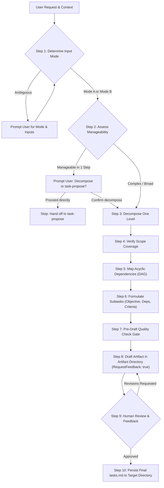

# Task Decomposition Skill (`task-decompose`)

This skill defines the standardized lifecycle for breaking complex engineering tasks into a structured, dependency-ordered set of abstract subtasks (one level at a time) that completely cover parent requirements without prescribing implementation details, following an interactive draft and human review flow.

> [!IMPORTANT]
> **Strict Separation of Concerns**:
> - **Content**: Use [tasks-template.md](./resources/tasks-template.md) and [sample-flow.md](./examples/sample-flow.md) **strictly for content**. They define WHAT abstract information to capture. Their visual presentation is neutral and must not be copied.
> - **Structure**: You **MUST structure the final artifact using the `hierarchical-outline` skill** ([hierarchical-outline](../hierarchical-outline/SKILL.md)). Transform all captured content into deep parent-child bullet hierarchies with zero prose paragraphs, and format all completion criteria as actionable checklist items (`- [ ]`).

---

## Core Principle

> **`tasks.md` is an abstract scope partition and sequencing document.** It defines **WHAT** sub-goals must be achieved, their prerequisite dependencies, and observable completion criteria. It does **not** specify file edits, class designs, function signatures, database schemas, or technical proposals—those belong exclusively to the subsequent `task-propose` phase.

---

## Rules the Skill Must Enforce

1. **Focus strictly on WHAT, never HOW**:
   - State subtask objectives and completion criteria in terms of system capabilities, domain boundaries, and observable outcomes.
   - Do not include method names, class names, file paths, database schemas, or code mechanics.
2. **Decompose only one level per invocation**:
   - Decompose into a single tier of subtasks (`T1`, `T2`, etc.). Deeper nested breakdowns require re-invoking the skill on selected task IDs.
3. **No combined mode**:
   - The skill operates either on `requirements.md` (Mode A) or existing task IDs from `tasks.md` (Mode B). Never combine modes.
   - If the input mode cannot be determined unambiguously, explicitly prompt the user for clarification.
4. **Prompt user on manageable tasks**:
   - If the task or requirement set is atomic enough to be addressed in a single technical proposal, prompt the user for confirmation: ask whether they prefer to proceed directly to `task-propose` or confirm decomposing it into subtasks.
5. **Inspect the codebase only for boundaries**:
   - Inspect workspace files *only* when strictly necessary to discover macroscopic component boundaries or dependency sequencing.
   - Never perform deep codebase analysis or root-cause diagnostics.
6. **Never modify source code**:
   - Output markdown specification artifacts only. Never edit or create source code files.
7. **Structure using the `hierarchical-outline` skill**:
   - Decompose all narrative content into parent bullets with indented sub-details.
   - Enforce one idea per bullet. Format completion criteria with task checkboxes (`- [ ]`). Prohibit prose paragraphs.
8. **Enforce human review before persistence**:
   - Always generate a draft artifact with `RequestFeedback: true` in the conversation artifact directory.
   - Persist to the target plan directory only after the user explicitly accepts and approves the draft.

---

## Transformation Example

- **Too specific & implementation-heavy**:
  ```markdown
  ## T1: Refactor repository to async Motor driver
  - Modify database/mongo.py to use AsyncIOMotorClient instead of PyMongo.
  - Change find_by_id() and insert_one() methods to async def.
  - Update unit tests in tests/test_db.py.
  ```

- **Correct & hierarchical**:
  ```markdown
  ## T1: Database and Repository Migration
  - Objective:
    - Transition all persistent storage operations to non-blocking execution.
    - Maintain data integrity and existing query semantics unchanged.
  - Dependencies:
    - None
  - Completion Criteria:
    - [ ] Persistent storage reads and writes execute asynchronously without stalling the calling thread.
    - [ ] Baseline query semantics, schemas, and persistence guarantees remain unaltered.
  ```

---

## Process Overview



---

## Step-by-Step Instructions

### Step 1: Ingest Inputs & Determine Mode
Identify the input mode:
- **Mode A: `requirements.md`**:
  - Source: A requirements specification file (e.g., `plan/<task-name>/requirements.md`).
  - Target Path Upon Approval: `<base_dir>/tasks.md`.
- **Mode B: Task IDs from `tasks.md`**:
  - Source: Explicit task IDs (e.g., `T1`, `T3`) from an existing `tasks.md`.
  - Target Path Upon Approval: `<base_dir>/<joined_ids>/tasks.md` (e.g., `plan/<task-name>/T1-T3/tasks.md`).

> [!CAUTION]
> If the mode or inputs cannot be determined unambiguously, **do NOT guess or merge modes**. Prompt the user directly:
> *"Please specify the decomposition mode: (A) Decompose a requirements document by providing its path, or (B) Decompose existing task IDs by providing the task IDs and `tasks.md` path."*

---

### Step 2: Assess Manageability & Prompt User
Evaluate whether the scope requires decomposition:
- If the scope is already bounded, cohesive, and manageable in a single implementation proposal:
  - **Prompt the user for confirmation**: Explain that the task appears atomic enough to implement directly in `task-propose`.
  - Ask: *"This task appears manageable as a single proposal. Would you like to proceed directly to `task-propose`, or would you like to confirm decomposing it into subtasks?"*
  - If the user selects `task-propose`, halt without generating a breakdown artifact.
  - If the user confirms decomposition, proceed to Step 3.
- If the scope is composite, multi-domain, or clearly requires multiple independent phases, proceed directly to Step 3.

---

### Step 3: Decompose into One Level of Subtasks
- Partition the parent scope into cohesive subtasks along architectural, functional, or operational boundaries.
- Keep all subtasks at the same abstraction tier.
- Assign sequential identifiers: `T1`, `T2`, `T3`, etc. (or child notation `T1.1`, `T1.2` for Mode B sub-breakdowns).

---

### Step 4: Verify Coverage & Scope Boundaries
- Cross-check that every aspect and requirement of the parent scope is accounted for across the subtasks.
- Ensure subtasks do not have unnecessary functional overlap.
- Verify that no requirements have been dropped or arbitrarily added.

---

### Step 5: Map Dependencies
- Determine execution prerequisites between subtasks (e.g., persistence foundations precede consumer pipelines).
- Enforce that the dependency graph is strictly acyclic (DAG).
- If an end-to-end integration or system verification subtask exists, make it depend on all functional subtasks.

---

### Step 6: Formulate Subtask Specifications
For each subtask, capture:
- **Title**: Clear, descriptive name of the subtask.
- **Objective**: Exactly what must be achieved (nested parent-child bullets, outcome-focused, zero "how").
- **Dependencies**: List of prerequisite task IDs or `None`.
- **Completion Criteria**: Observable, verifiable outcomes formatted as task checkboxes (`- [ ]`).

---

### Step 7: Pre-Draft Quality Check Gate
Before creating the draft artifact, verify that both the abstraction rules and structural mandates are satisfied:

> [!CAUTION]
> **Pre-Draft Verification**:
> - [ ] **Structural Mandate Applied**: Formatted using the `hierarchical-outline` skill ([hierarchical-outline](../hierarchical-outline/SKILL.md)).
> - [ ] **Zero Prose Paragraphs**: All narrative blocks decomposed into parent bullets and indented sub-bullets (depth 2–5).
> - [ ] **Zero Implementation Mechanics**: No class names, file paths, method signatures, or technical designs.
> - [ ] **Single Abstraction Tier**: All subtasks exist at an equivalent level of granularity.
> - [ ] **Acyclic Flow**: Dependency graph is a valid DAG with no circular waits.
> - [ ] **Verifiable Criteria**: Completion criteria use task checkboxes (`- [ ]`) and state observable outcomes.
> - [ ] **Terminal Verification Dependency**: Final integration verification depends on all prior subtasks.

If any check fails, rewrite the offending content into nested parent-child bullet hierarchies before drafting.

---

### Step 8: Generate Draft `tasks.md` Artifact

**Follow the [Output Template Specification](#output-template-specification)**

Create the draft artifact in the conversation artifact directory (`<Artifact Directory>/tasks_draft.md` or `<Artifact Directory>/tasks.md`) using `write_file` with:
```json
{
  "ArtifactMetadata": {
    "Summary": "Draft task breakdown for <task-name>",
    "UserFacing": true,
    "RequestFeedback": true
  }
}
```

Notify the user in chat with a clickable link to the draft artifact, highlight key breakdown aspects (subtasks, dependencies, completion criteria), and invite their review. Do not duplicate the entire artifact body in the chat response.

---

### Step 9: Human Review & Iteration
1. Await user feedback on the draft task breakdown artifact.
2. If the user requests updates, scope adjustments, or re-ordering:
   - Re-apply the pre-draft quality check gate.
   - Update the draft artifact via `write_file` or `edit_file` with `RequestFeedback: true`.
3. Proceed to Step 10 only after the user explicitly accepts and approves the task breakdown.

---

### Step 10: Persist Final Output to Target Directory
1. Once approved, write the finalized task breakdown to the target path:
   - **Mode A**: `<base_dir>/tasks.md` (e.g., `plan/<task-name>/tasks.md`)
   - **Mode B**: `<base_dir>/<joined_ids>/tasks.md` (e.g., `plan/<task-name>/T1-T3/tasks.md`)
2. Provide a clean confirmation message in chat with:
   - A clickable file link to the persisted `tasks.md`.
   - Clear recommendation to transition to `task-propose` for the first subtask (e.g., `T1`).

---

## Output Template Specification

- **Content Definition**: [resources/tasks-template.md](./resources/tasks-template.md) & [examples/sample-flow.md](./examples/sample-flow.md) (defines WHAT content to capture)
- **Structural Formatting**: [hierarchical-outline skill](../hierarchical-outline/SKILL.md) (you **MUST structure the artifact using this skill**)
