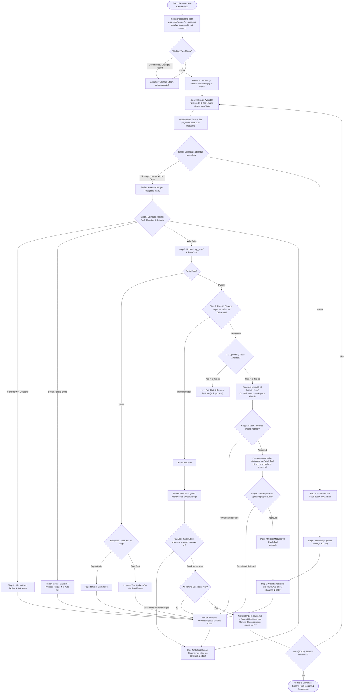

# Task Execution Loop Skill (`task-execute-loop`)

Summary: Orchestrates a human-in-the-loop pair programming execution engine over tasks specified in `proposals/[name]/proposal.md`. Tracks execution progress, task states, and decision logs in a companion `status.md` file. Uses git state to cleanly separate agent implementations from unreviewed human edits, enforces task objectives as the source of truth, protects test suite integrity, and commits only at task boundaries.

---

## Operating Inputs & File Roles

- **Input Blueprint (`proposals/[name]/proposal.md` or `plan/<name>/.../proposal.md`)**:
  - The authoritative architectural and contract blueprint.
  - Contains task objectives, interfaces, data models, and acceptance criteria.
  - Remains clean and stable: updated **only** when architectural contracts or schemas intentionally change via an approved impact diff.
- **Execution Tracker (`status.md`)**:
  - Resides alongside `proposal.md` in the same directory (e.g., `proposals/[name]/status.md`).
  - Tracks task progress (`[TODO]`, `[IN_PROGRESS]`, `[IN_REVIEW]`, `[DONE]`), test verification checklists, active task context, and the per-task `Decisions Log`.
  - Initialized automatically from `proposal.md` if not present (per [proposal-state-schema.md](./resources/proposal-state-schema.md)).

---

## Core Idea: Git State Separates Who Changed What

The workspace git state provides an unambiguous channel separating human edits from agent work:

- **Committed State (`git commit`)**: Represents the immutable checkpoint of the last completed task (plus the baseline commit at proposal start).
- **Staged State (`git add .`)**: Represents approved / presented changes for the current task (including code and `status.md`) that the human has already seen or reviewed.
- **Unstaged State (`git diff` / `git status --porcelain`)**: Represents human work that the agent has not yet reviewed.

This separation holds only if every agent edit goes through the patch tool and is followed immediately by `git add .` (and `git add -N <file>` for untracked files). The human then accepts, rejects, or modifies changes in their editor or through the patch UI (never through git staging). Anything the human changes shows up as an unstaged diff.

> [!CAUTION]
> - **Never use git staging as the review UI.**
> - **Never edit files by any route other than the patch tool.**
> - **Never run `git commit` mid-task.** Commits mark task boundaries only.

---

## 4 Rules That Keep the Signal Clean

1. **Read before you patch**:
   - Before applying every patch, run `git status --porcelain` and `git diff`.
   - If there is any unstaged change, it is a human change: review it (Step 4 & 5) before patching.
   - Otherwise, running `git add .` after your patch will silently absorb human edits you never examined.
2. **Untracked files count**:
   - `git diff` ignores new files by default.
   - Always run `git status --porcelain` to detect new files.
   - Use `git add -N <file>` immediately so untracked files appear in standard diff outputs.
3. **Wait for the patch decision**:
   - After applying a patch, the human may accept, reject, or edit hunks.
   - Run `git add .` once the patch is applied.
   - Treat any later difference against that staged state as the human's accept/reject/edit outcome.
   - Always re-read `git diff` before assuming your patch landed exactly as written.
4. **Objective is the source of truth**:
   - When reviewing and judging human changes, compare against the task objective and acceptance criteria in `proposal.md`—not against your own previous code.

---

## 9 Operational Guardrails

1. **Objective is the Source of Truth**:
   - Each task in `proposal.md` has an objective and acceptance criteria.
   - When human edits conflict with them: flag the discrepancy, state the exact conflict, and ask for user intent.
   - Never silently revert a human change; never silently accept an incompatible change.
2. **Report Problems in Human Changes; Do Not Auto-Fix**:
   - For logical errors, missing imports, or type mismatches: flag the issue, explain what is wrong and why, propose a fix, and wait.
   - Exception: Execution-blocking syntax errors (e.g., Python `SyntaxError`) that prevent test execution may be proposed or fixed only after explicitly declaring every touched token.
3. **Restricted Scope, Impact Artifacts & Two-Stage Approval**:
   - Never update other modules or `proposal.md` autonomously.
   - **Do not persist impact lists to project storage**. Render impact analyses strictly as conversation artifacts (`<appDataDir>\brain\<conversation-id>/impact-list-<Tid>.md` with `RequestFeedback: true`).
   - **Structure via `hierarchical-outline`**: You **MUST structure the Impact List artifact strictly using the `hierarchical-outline` skill** ([hierarchical-outline](../hierarchical-outline/SKILL.md)), enforcing deep nested bullets (depth 2–5) with zero prose paragraphs.
   - Follow the **Two-Stage Approval Gate**:
     - *Stage 1*: User approves the Impact List artifact.
     - *Stage 2*: Agent patches `proposal.md`, stages it, presents the updated proposal diff, and **waits for user approval of the updated proposal** before touching any secondary code modules.
4. **Stop Agent from Bending Tests to Pass**:
   - Never modify or loosen tests simply to make them green.
   - When a test fails, classify the cause:
     - *Case A (Stale Test)*: Contract intentionally changed per user direction; propose updating the test to reflect the new contract.
     - *Case B (Bug)*: Code introduced an unintended defect; fix the implementation while keeping tests intact.
   - Place in-progress tests strictly in `loop_tests/` (per `code/AGENT.md`). Protect curated test suites (`tests/` or `test_suite/`).
5. **Strict Definition of Done**:
   - Never advance to the next task on your own. A task is done only when:
     - [ ] Acceptance criteria in `proposal.md` are met.
     - [ ] Tests in `loop_tests/` pass.
     - [ ] Existing curated test suite passes without regressions.
     - [ ] The human explicitly approves after reviewing `git diff HEAD --stat` and the full diff.
6. **Trustworthy Checkpoints**:
   - Commits mark checkpoints of completed tasks.
   - Staging (`git add .`) establishes the baseline for the current task so `git diff` cleanly reveals the human's contribution.
7. **Track Progress in `status.md`**:
   - Maintain task states (`[TODO]`, `[IN_PROGRESS]`, `[IN_REVIEW]`, `[DONE]`) in `status.md`.
   - Record architectural choices, scope alterations, and deviations in the `Decisions Log` in `status.md`.
8. **Loop Exit Circuit Breaker**:
   - If a behavioral change cascades into more than two upcoming tasks ($> 2$ tasks affected in `proposal.md`), halt execution immediately.
   - Request a formal re-plan via `task-propose` instead of patching tasks one by one.
9. **Classification Rule of Thumb (Behavioral vs Implementation)**:
   - *Implementation Change*: Internal refactoring, optimization, local logic change preserving existing signatures and contracts. Update loop tests and notes only.
   - *Behavioral Change*: Modifies public interface, signatures, parameter types, return values, schemas, error behaviors, or cross-module contracts.
   - *Default*: If in doubt, treat as Behavioral and generate an Impact List artifact.

---

## State Machine & Execution Flowchart



---

## Step-by-Step Instructions

### Start (First Task Only)

1. **Locate Proposal Blueprint**:
   - Target path: `proposals/[name]/proposal.md` (or `plan/<base-task>/.../proposal.md`).
   - If ambiguous, prompt the user to confirm the target proposal.
2. **Initialize Execution Tracker (`status.md`)**:
   - Check if `status.md` exists in the proposal directory.
   - If missing, initialize `status.md` following [proposal-state-schema.md](./resources/proposal-state-schema.md), listing all tasks extracted from `proposal.md` as `[TODO]`.
3. **Verify Git State**:
   - Run `git status --porcelain`.
   - If the working tree has uncommitted changes, prompt the user how to handle them.
   - Once clean, execute the baseline commit:
     ```bash
     git commit --allow-empty -m "start: <proposal name>"
     ```

---

### For Each Task

#### Step 1: Display Available Tasks in UI & Ask User to Select Next Task

1. **Extract Available Tasks from `status.md`**:
   - Read `status.md` to identify all tasks and their current states (`[DONE]`, `[TODO]`, `[IN_PROGRESS]`).
2. **Display Available Tasks in UI**:
   - Render a scannable table in chat listing all tasks, their IDs, titles, and current statuses:
     ```markdown
     ### Available Tasks from status.md
     | Task ID | Task Title | Status |
     | :--- | :--- | :--- |
     | T1 | Pluggable Storage Abstraction Layer | [DONE] |
     | T2 | Document Service Orchestration | [TODO] |
     | T3 | Ingestion Pipeline Migration | [TODO] |
     ```
3. **Ask User for Next Task**:
   - Prompt the user to select the next task to work on (or use the `ask_question` tool with options, placing `(Recommended) T<n>: <title>` first).
   - Never assume or pick a task autonomously without explicit user selection or confirmation.
4. **Set Active Task State**:
   - Once the user confirms or selects the task, update that task's status to `[IN_PROGRESS]` in `status.md`.
   - Stage the tracker update: `git add status.md`.
5. **Re-Read Task Blueprint**:
   - Re-read the selected task's **Objective**, **Acceptance Criteria**, signatures, data models, and verification steps in `proposal.md`.

#### Step 2: Implement via Patch Tool
1. Run `git status --porcelain` and `git diff` to ensure no unreviewed human changes exist before patching.
2. Implement code changes and exploratory tests strictly using the patch tool.
   - In-progress tests go in `loop_tests/`, mirroring the source path (e.g., `loop_tests/services/test_document_service.py`).
   - Do NOT edit files in `tests/` or `test_suite/`.
3. If new files were created, add them with intent: `git add -N <file>`.
4. Stage agent changes and tracker immediately:
   ```bash
   git add .
   ```

#### Step 3: Show for Review & Stop
1. Update active task status in `status.md` to `[IN_REVIEW]`.
2. Summarize what was changed, which files were touched, and the test results.
3. Stage `status.md`: `git add status.md`.
4. **STOP calling tools and wait for the human to review, accept/reject patches, or edit code directly.**

#### Step 4: Collect Human Changes
1. When the user responds, run:
   ```bash
   git status --porcelain
   git diff
   ```
2. Any unstaged changes or untracked files are strictly human work.

#### Step 5: Review Human Changes Against Objective
1. Compare unstaged human edits against the task **Objective** and **Acceptance Criteria** in `proposal.md`.
2. If a conflict or accidental deviation is found:
   - Flag it directly: explain the conflict, cite the acceptance criterion, and ask for clarification.
   - Do not silently overwrite or silently accept it.
3. If human changes contain logic or syntax issues:
   - Report the issue, explain why it fails, propose a concrete fix, and wait.
   - Do not automatically patch human mistakes.

#### Step 6: Update Tests and Run Code
1. Adjust tests in `loop_tests/` to align with confirmed human edits.
2. Execute `loop_tests/` and the curated regression suite (`pytest`).
3. If tests fail:
   - Fix failures originating from your own agent code.
   - For failures tracing to human changes, classify as **Stale Test** (propose updating test) vs **Bug** (report regression to user). Never bend tests just to make them pass.

#### Step 7: Classify Each Change & Two-Stage Approval

1. **Implementation Change**:
   - Internal optimization, variable renaming, or refactoring without contract changes.
   - Update affected loop tests, stage, and continue to pre-commit check.
2. **Behavioral Change**:
   - Modifies public interface, schemas, status codes, or cross-module contracts.
   - **Check Cascade**: Count affected upcoming tasks in `proposal.md`. If $> 2$, trigger **Loop Exit** and ask user for a formal re-plan via `task-propose`.
   - **Generate Impact List Artifact**:
     - Do **NOT** write the impact list to persistent project storage (`plan/` or `code/`).
     - Write it as a conversation artifact: `<appDataDir>\brain\<conversation-id>/impact-list-<Tid>.md` using [impact-list-template.md](./resources/impact-list-template.md) with `RequestFeedback: true`.
     - Structure strictly using `hierarchical-outline`: Transform into nested parent-child bullet hierarchies with zero narrative prose paragraphs.
     - Point the user to the artifact and wait for **Stage 1 Approval**.
   - **Stage 2: Proposal Update & Approval Gate**:
     - Upon Stage 1 approval, apply the proposed diff to `proposal.md` and update `status.md` using the patch tool.
     - Stage changes: `git add <proposal_path> <status_path>`.
     - Present the updated `proposal.md` diff to the user.
     - **STOP and wait for explicit Stage 2 Approval on the updated `proposal.md`** before modifying any downstream modules!
   - **Downstream Implementation**:
     - Once the updated `proposal.md` is approved, apply updates to the affected codebase modules and loop tests using the patch tool.
     - Stage changes: `git add .`.

#### Step 8: Loop Back
Loop back to Step 3 until the user is satisfied with all changes for the current task.

---

### Before Moving to the Next Task

1. Open the source-control view of everything changed since the checkpoint commit:
   ```bash
   git diff HEAD --stat
   git diff HEAD
   ```
2. Walk the human through the cumulative changes.
3. Ask one explicit question:
   > *"Have you made any further changes, or are we ready to commit this task and move to the next?"*
4. Branch on user response:
   - **User made further changes**: Return to Step 4 (collect human changes).
   - **Ready to move on**:
     1. Verify all 4 Done conditions:
        - [x] Acceptance criteria in `proposal.md` met.
        - [x] `loop_tests/` pass.
        - [x] Existing curated test suite passes without regression.
        - [x] Human explicit approval granted.
     2. Update task badge in `status.md` to `[DONE]`.
     3. Append entry to `Decisions Log` in `status.md` if any behavioral changes or design decisions occurred.
     4. Commit task boundary checkpoint:
        ```bash
        git add .
        git commit -m "T<n>: <task title>"
        ```
     5. Advance to Step 1 for the next task.

---

### Done (Proposal Complete)

When all tasks in `status.md` are marked `[DONE]`:
1. Confirm final task commit.
2. Present a final summary of all implemented tasks and highlight which behavioral decisions updated `proposal.md`.
3. Update `status.md` overall state to `Complete`.
4. Provide instructions on running the full regression test suite.

---

## Things to Avoid

- **Writing impact lists to workspace files**: Impact lists belong strictly in conversation artifacts, never committed to project git repositories.
- **Skipping the proposal approval gate**: Never patch secondary code modules before the user has explicitly approved the updated `proposal.md`.
- **Bypassing the patch tool**: Never edit workspace files through unauthorized scripts or shell writes; always use the patch tool.
- **Premature staging**: Never run `git add` before the patch is applied.
- **Patching over unreviewed edits**: Never apply patches while unreviewed unstaged changes exist. Always read `git status --porcelain` and `git diff` first.
- **Silently reverting human code**: Never overwrite, revert, or "clean up" human changes without explicit explanation and permission.
- **Mid-task commits**: Never commit intermediate work; commits mark task boundaries and the initial baseline only.
- **Bending tests**: Never delete or weaken test assertions just to get a green test run.
- **Picking tasks autonomously**: Never assume or advance into a task without displaying available tasks in the UI and asking the user to choose or confirm the next task.
- **Advancing without confirmation**: Never proceed to the next task without the pre-commit diff walkthrough and explicit human approval.
