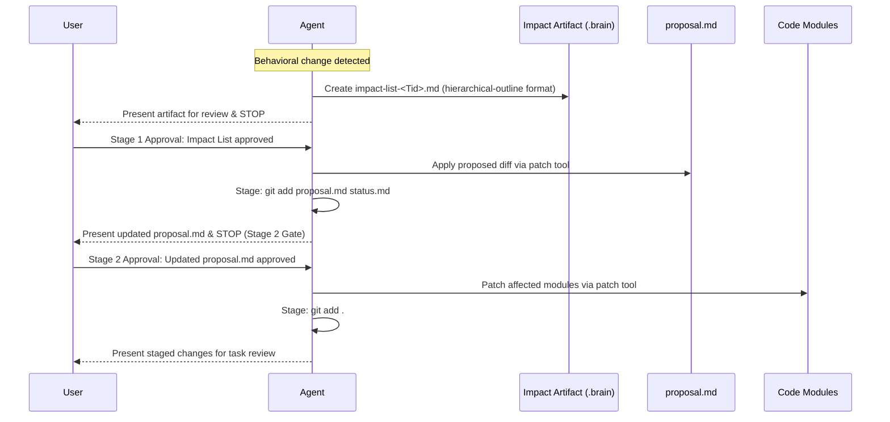

# Behavioral Impact List & Proposal Diff Template

Summary: Governs how behavioral changes are analyzed, presented, and approved during `task-execute-loop`. Employs a non-persistent artifact presentation formatted strictly using the `hierarchical-outline` skill, followed by a two-stage approval gate before mutating `proposal.md` or secondary codebase modules.

> [!IMPORTANT]
> **Strict Separation of Concerns**:
> - **Content**: Use this template strictly for **content**. It defines what impact dimensions, affected modules, downstream tasks, and proposal diffs must be captured.
> - **Structure**: You **MUST structure the Impact List artifact strictly using the `hierarchical-outline` skill** ([hierarchical-outline](../hierarchical-outline/SKILL.md)). Transform all analysis into visual hierarchical parent-child bullets (depth 2–5) with zero verbose narrative paragraphs.

---

## Behavioral Classification Criteria

A change is classified as **Behavioral** if it alters:
- Public interfaces, method names, argument lists, or return types.
- Data schemas, Pydantic/dataclass models, database documents, or storage keys.
- Error behaviors, thrown exceptions, status codes, or failure modes.
- Any contract or component that another module or downstream task depends upon.

> [!TIP]
> **Rule of Thumb**: If uncertain whether a change is implementation-only or behavioral, always treat it as **Behavioral** and generate an Impact List artifact.

---

## Storage Rule: Transient Artifact Only (Never Persist to Project)

> [!CAUTION]
> **Do NOT store the impact list directly in project storage.**
> - Do NOT write files like `impact-list.md` into `code/`, `plan/`, or `proposals/`.
> - Always generate the Impact List as a conversational artifact located in:
>   `<appDataDir>\brain\<conversation-id>/impact-list-<Tid>.md`
> - Set `ArtifactMetadata.RequestFeedback: true` and `ArtifactMetadata.UserFacing: true`.
> - The impact list is transient review information; long-term rationale is preserved in `status.md` under the `Decisions Log`.

---

## Cascade Circuit Breaker (Loop Exit)

Before generating the Impact List artifact, count the number of upcoming tasks in `proposal.md` affected by the change:
- **$\le 2$ upcoming tasks affected**: Proceed with the Impact List artifact.
- **$> 2$ upcoming tasks affected**: **STOP immediately**. Trigger a Loop Exit: halt piecemeal patching and prompt the user for a formal re-plan via `task-propose` or `task-decompose`.

---

## Artifact Content Schema (Structured via `hierarchical-outline`)

Write the artifact in `<appDataDir>\brain\<conversation-id>/impact-list-<Tid>.md` adhering strictly to `hierarchical-outline` principles (Title → Summary → Headings → Nested Bullets):

```markdown
# Behavioral Impact Analysis: Task <Tid>

Summary: <1-2 sentences distilling the behavioral change, driver, and affected scope>

## Triggering Modification

Change Origin:
- Source: <Human edit in <file> | Agent architectural discovery>
- Contract Alteration:
  - Previous Signature: `<old_signature>`
  - New Signature: `<new_signature>`
  - Rationale: <Why this contract changed>

## Codebase Ripple Effect

Impacted Files & Modules:
- `<file_path_1>`:
  - Role: <Direct implementer | Caller | Interface definition>
  - Required Adaptation: <Specific parameter or return type adjustment>
- `<file_path_2>`:
  - Role: <Downstream consumer>
  - Required Adaptation: <Call site update>

## Downstream Task Alignment

Impacted Tasks in proposal.md:
- `<T_next_1>`:
  - Scope Change: <How this task's scope or signatures are altered>
  - Verification Impact: <New or modified acceptance criteria needed>
- `<T_next_2>`:
  - Scope Change: <How this task's scope or signatures are altered>
- Cascade Metric:
  - Affected Tasks: <N> upcoming tasks
  - Threshold Status: Valid ($\le 2$ tasks affected; proceed with impact list)

## Proposed proposal.md Diff

Architectural Blueprint Patch:
- Unified diff representing exact updates required in `proposals/<name>/proposal.md`:
  ```diff
  --- a/proposals/<name>/proposal.md
  +++ b/proposals/<name>/proposal.md
  @@ -120,6 +120,7 @@
  - async def store_file(key: str, data: bytes) -> str:
  + async def store_file(key: str, data: bytes, mime_type: str = "application/octet-stream") -> StorageResult:
  ```

## Verification & Approval Checklist

- [ ] Stage 1: Human approves this Behavioral Impact List artifact.
- [ ] Stage 2: Human approves the applied proposal.md diff (presented after Stage 1).
```

---

## Two-Stage Approval Gate

To eliminate scope creep and accidental multi-file mutations, the agent must execute these two sequential approval gates:



1. **Stage 1: Impact List Artifact Approval**:
   - Present the artifact to the user. Stop and await approval.
   - Do NOT edit `proposal.md` or other code modules yet.
2. **Stage 2: Proposal Update & Proposal Approval Gate**:
   - Once Stage 1 is approved, patch `proposal.md` with the proposed diff and update `status.md`.
   - Stage the changes: `git add <path>/proposal.md <path>/status.md`.
   - Present the updated `proposal.md` diff to the user.
   - **STOP and wait for user approval on the updated `proposal.md`** before touching any secondary code modules!
3. **Stage 3: Downstream Implementation**:
   - Only after the user confirms the updated `proposal.md` does the agent patch the affected codebase modules and loop tests.
