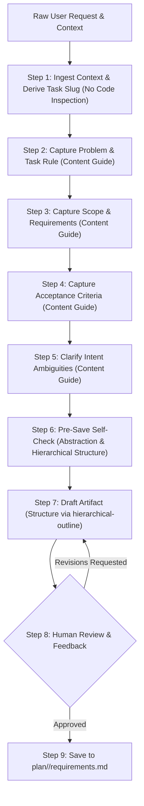

# Task Initialization Skill (`task-init`)

This skill defines the standardized lifecycle for ingesting a raw user task, clarifying intent interactively, producing an abstract requirements artifact focused strictly on **WHAT** must be done and **HOW TO VERIFY** it (never **HOW** to implement it), and persisting the approved specification into `plan/<task-name>/requirements.md`.

> [!IMPORTANT]
> **Strict Separation of Concerns**:
> - **Content**: Use [requirements-template.md](./resources/requirements-template.md) and [sample-flow.md](./examples/sample-flow.md) **strictly for content**. They define WHAT abstract information to capture. Their visual presentation is neutral and must not be copied.
> - **Structure**: You **MUST structure the final artifact using the `hierarchical-outline` skill** ([hierarchical-outline](../hierarchical-outline/SKILL.md)). Transform all captured content into deep parent-child bullet hierarchies with zero prose paragraphs.

---

## Core Principle

> **`requirements.md` is a problem-and-intent document.** It is written strictly from the user's request and conversation context—**not** from reading or exploring the codebase. Reading code, choosing files, inspecting libraries, and designing the solution belong exclusively to the later design/planning phase.

---

## Rules the Skill Must Enforce

1. **Do not explore the codebase** while generating `requirements.md`. Use only the user's request and any context they directly provide. If something is unclear or unspecified, ask the user instead of inspecting code or searching files.
2. **Do not include:**
   - Code snippets, signatures, schemas, or interface examples
   - File paths, directory names, module names, class names, function names, or library/package names (unless the user explicitly named them as a constraint)
   - Layer-by-layer or component-by-component breakdowns
   - Current-state analysis, root-cause investigations, or diagnostic reports
3. **Describe the task as a rule, not a checklist of changes.** For example, write *"Replace every blocking external call with a non-blocking equivalent"* instead of listing each file or layer to modify.
4. **Use abstract terms:** "external dependency", "data store", "request path", "background process", "client identifier"—not specific technologies, unless a specific technology is a user-stated constraint.
5. **Requirements must be testable.** Each requirement states an outcome, and each acceptance criterion states how to confirm it, phrased as an observable, verifiable result.
6. **Structure the document using the `hierarchical-outline` skill.**
   - Content and structure are decoupled: `requirements-template.md` defines content domains; the `hierarchical-outline` skill defines formatting.
   - Decompose all narrative content (Problem Statement, Task, Requirements, Acceptance Criteria) into parent bullets with indented sub-details (depth 2–5).
   - Enforce one idea per bullet with indented sub-details (rationale, conditions, edge cases).
   - Prohibit flat multi-sentence prose paragraphs, flat numbered lists, and unindented checklist lines.
7. **Keep it short.** Aim for one page. If a section only restates another, merge or remove it.
8. **Preserve behavior by default.** Unless the task explicitly specifies otherwise, always include a requirement that existing behavior, functionality, and contracts remain unchanged.
9. **Defer decisions.** Choices about specific tools, drivers, data structures, and architecture belong in the design phase. Only record them under "Resolved Ambiguities" if the user explicitly decided them, and phrase them strictly at the decision level, not the implementation level.

---

## Transformation Example

- **Too specific & flat**: *"Refactor the repository interface and retriever to use async methods and call the LLM with its async invoke."*
- **Correct & hierarchical**:
  - Replace blocking operations across external dependencies:
    - Target: Transition every blocking call to a non-blocking equivalent.
    - Callers: Ensure all calling workflows await asynchronous responses.
    - Contracts: Preserve existing return structures and error behaviors unchanged.

---

## Process Overview



---

## Step-by-Step Instructions

### Step 1: Ingest Context & Derive Task Slug
1. Parse the user's prompt and any background context provided in conversation.
   > [!IMPORTANT]
   > **Do not inspect the workspace or read code files.** Rely solely on the user's stated problem and context.
2. Derive a clean, kebab-case task slug for the output folder name (e.g., `async-external-calls`, `api-rate-limiting`).

---

### Step 2: Define Problem Statement & Task Rule
Extract the problem and task content based on [requirements-template.md](./resources/requirements-template.md):
1. **Problem Statement**: Capture what is wrong or missing, and why it matters (no code analysis).
2. **Task**: Define the work as a general rule without prescribing implementation mechanics.

---

### Step 3: Define Scope & Numbered Requirements
1. **Scope Boundaries**:
   - **In Scope**: Abstract deliverables and functional boundaries.
   - **Out of Scope**: Explicitly excluded or deferred items.
2. **Requirements**:
   - Outcome-based statements describing desired system results.
   - Always include a requirement preserving existing behavior and contracts unchanged unless the user requested breaking changes.

---

### Step 4: Extract Observable Acceptance Criteria
1. Formulate acceptance criteria as observable, verifiable outcomes.
2. Include verifiable conditions (stimulus, input condition, and observable result) for each criterion.

---

### Step 5: Clarify Ambiguities & Defer Implementation Decisions
1. Identify underspecified requirements or intent-level choices.
2. Clarify interactively with the user (via `ask_question` or conversation).
3. Defer architectural and technical implementation decisions to the design phase.
4. Record user-confirmed decisions under **Resolved Ambiguities** with their intent-level rationale.

---

### Step 6: Mandatory Pre-Save Self-Check Gate
Before drafting or updating the requirements document, verify that both the abstraction rules and the structural mandate are satisfied:

> [!CAUTION]
> **Self-Check Verification**:
> - [ ] **Structural Mandate Applied**: Content is structured strictly using the `hierarchical-outline` skill ([hierarchical-outline](../hierarchical-outline/SKILL.md)).
> - [ ] **Zero prose paragraphs**: All narrative blocks are decomposed into parent bullets and indented sub-bullets (depth 2–5).
> - [ ] **No flat lists**: Requirements and acceptance criteria are formatted as multi-level parent-child bullets, not flat numbered lists or single-line checklists.
> - [ ] **Zero code blocks or code snippets** (only the markdown structure itself).
> - [ ] **Zero file paths, directory paths, or module paths**.
> - [ ] **Zero class names, method names, or function names**.
> - [ ] **Zero layer-by-layer or component-by-component breakdowns**.
> - [ ] **Abstract terminology used throughout** ("external dependency", "data store", "request path").
> - [ ] **Length fits on approximately one page**.

If any check fails, rewrite the offending content into nested parent-child bullet hierarchies and general rules before proceeding.

---

### Step 7: Generate the `requirements.md` Artifact

**Follow the [Output Template Specification](#output-template-specification)**

> [!WARNING]
> **Prevent Anchor Bias**:
> `requirements-template.md` and `sample-flow.md` define **content only**. Do NOT copy their flat visual layout. You **MUST apply the `hierarchical-outline` skill** to structure the final document into nested parent-child bullet hierarchies (`Title` → `Summary` → `Headings` → `Nested Bullets`). Emitting flat text or flat lists fails the structural mandate.

Create the artifact using `write_file` in the conversation artifact directory (`<Artifact Directory>/requirements_draft.md` or `<Artifact Directory>/requirements.md`) with:
```json
{
  "ArtifactMetadata": {
    "Summary": "Draft requirements specification for <task-name>",
    "UserFacing": true,
    "RequestFeedback": true
  }
}
```

Notify the user in conversation with a clickable link to the artifact and invite their review. Do not repeat the entire artifact body in the chat response.

---

### Step 8: Human Review & Iteration
1. Await user feedback on the requirements artifact.
2. If the user requests updates or scope adjustments:
   - Re-apply the self-check verification.
   - Update the artifact via `write_file` or `edit_file` with `RequestFeedback: true`.
3. Proceed to Step 9 only after the user explicitly accepts and approves the requirements.

---

### Step 9: Persist Final Output in `plan/<task-name>/requirements.md`
1. Once approved, write the finalized requirements document to `plan/<task-name>/requirements.md`.
2. Provide a clean confirmation message in chat with:
   - A clickable file link to `plan/<task-name>/requirements.md`.
   - The recommended next phase (e.g., transition to `/plan` for architecture and code design).

---

## Output Template Specification

- **Content Definition**: [resources/requirements-template.md](./resources/requirements-template.md) & [examples/sample-flow.md](./examples/sample-flow.md) (defines WHAT content to capture)
- **Structural Formatting**: [hierarchical-outline skill](../hierarchical-outline/SKILL.md) (you **MUST structure the artifact using this skill**)
