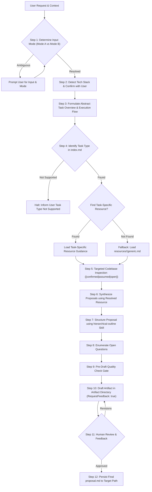

# Technical Proposal Skill (`task-propose`)

This skill defines the standardized lifecycle for taking a selected task or set of subtasks, grounding them in the codebase through targeted inspection, resolving task-type domain resources, and generating a rigorous, reviewable technical proposal that specifies **what changes are proposed and how they should work**, without implementing them or modifying source code.

> [!IMPORTANT]
> **Strict Separation of Concerns**:
> - **Content**: Use resources under [`resources/`](./resources/index.md) **strictly for content**. They define domain checklists, contracts, and specialized schemas.
> - **Structure**: You **MUST structure the final artifact using the `hierarchical-outline` skill** ([hierarchical-outline](../hierarchical-outline/SKILL.md)).

---

## Core Principle

> **`proposal.md` is an architectural design and contract specification document.** It defines **WHAT** components, interfaces, contracts, schemas, and control flows are proposed, and **HOW** they will operate and be verified. It does **not** implement source code, edit existing files, or execute migrations.

---

## Operating Modes & Target Output Paths

The skill operates in two distinct modes, mirroring `task-init`:

| Mode | Input Source | Target Output Path | Use Case |
| :--- | :--- | :--- | :--- |
| **Mode A** | `requirements.md` | `plan/<base-task>/proposal.md` | Atomic tasks where requirements can be proposed directly without decomposition. |
| **Mode B** | Task ID(s) from `tasks.md` | `plan/<base-task>/<Tid1-Tid2-...>/proposal.md` | Decomposed tasks targeting one or more specific subtask IDs (e.g., `T1/` or `T1-T2/`). |

If input mode is ambiguous, explicitly prompt the user for clarification before proceeding.

---

## Rules the Skill Must Enforce

1. **Focus strictly on WHAT and HOW, never implement**:
   - Define architectural components, contracts, interfaces, data models, error mappings, and verification criteria.
   - Never edit or create source code files (`.py`, `.ts`, `.go`, etc.) or execute database migrations.
2. **Present abstract overview first, then individual proposals**:
   - Provide an abstract proposal header outlining the overarching task objective and the execution flow of all subtasks.
   - For each ordered subtask, generate its detailed proposal based on the resolved domain resource.
3. **Detect, confirm, and declare Tech Stack**:
   - Inspect workspace dependencies (`pyproject.toml`, `package.json`, `go.mod`, etc.) and codebase files to identify the active tech stack.
   - If found, prompt the detected tech stack to the user for confirmation; if not found or ambiguous, prompt the user to specify it.
   - Explicitly declare the tech stack in both the document-level and individual task headers.
4. **Identify Task Type from index; halt if unsupported**:
   - Identify the primary task type from [`resources/index.md`](./resources/index.md).
   - If a suitable task type is not found, stop immediately and tell the user that the specific task type is not supported.
5. **Resolve Task-Specific to Generic Resource**:
   - Once the task type is confirmed, attempt to find the task-specific resource under `resources/<TASK_TYPE>/...` (e.g., `backend/api_endpoint.md`, `backend/module.md`).
   - If a matching task-specific resource is not found, fall back to using the task type's generic resource at `resources/<TASK_TYPE>/generic.md`.
   - If neither a specific resource nor `generic.md` exists, ask the user whether to continue using agent knowledge (`Resource: Not present`) or halt.
6. **Grounded codebase inspection only**:
   - Inspect only files and modules directly implicated by the task.
   - Ground all observations in code; record findings using `[confirmed]`, `[assumed]`, or `[open]`. Never invent codebase structure.
7. **Synthesize proposals strictly using referenced resource instructions**:
   - After codebase inspection, synthesize the proposal for each task strictly following the instructions, structural checklist, and context format provided in the referenced resource file.
8. **Structure strictly using the `hierarchical-outline` skill**:
   - Structure the output as Title → Summary → Headings → Nested Bullets (depth 2–5).
   - Enforce one idea per bullet with indented sub-details. Prohibit narrative prose paragraphs.
   - Format all verification criteria and acceptance checks with task boxes (`- [ ]`).
9. **Smallest coherent solution**:
   - Avoid unsolicited refactoring, unnecessary dependencies, or architectural scope creep.
10. **Enforce human review before persistence**:
   - Generate a draft artifact with `RequestFeedback: true` in the conversation artifact directory.
   - Persist to the target plan path only after the user explicitly accepts and approves the draft.

---

## Structural Format Requirement (`hierarchical-outline`)

You **MUST strictly structure the proposal using the `hierarchical-outline` skill** 

---

## Process Overview



---

## Step-by-Step Instructions

### Step 1: Ingest Inputs & Determine Mode
1. Parse the user's prompt, requirements, or task arguments:
   - **Mode A**: Ingest `requirements.md` directly when requirements are atomic. Target: `plan/<base-task>/proposal.md`.
   - **Mode B**: Ingest specific task ID(s) from `tasks.md` (e.g. `T1` or `T1, T2`). Target: `plan/<base-task>/<Tid1-Tid2-...>/proposal.md`.
2. Read parent context from `requirements.md` to ground requirements, constraints, and scope boundaries.

---

### Step 2: Detect Tech Stack & Confirm with User
1. Inspect workspace dependencies, configuration files, and source code (e.g., `pyproject.toml`, `requirements.txt`, `package.json`, `go.mod`, `pom.xml`, or source file extensions).
2. Identify primary programming language, core framework(s), storage/drivers, and runtime environment.
3. **User Confirmation**:
   - If found: Prompt the user with the detected tech stack (e.g., *"Detected tech stack: Python 3.11, FastAPI, MongoDB (Motor). Proceeding with these conventions."*).
   - If not found or ambiguous: Prompt the user directly to specify the target language and framework before proceeding.
4. Record the confirmed tech stack in the proposal metadata and use its syntax for all code blocks.

---

### Step 3: Formulate Abstract Task Overview & Execution Flow
Construct the top-level document header establishing the global context and sequencing:
- Document Title & Summary.
- Base task metadata, operating mode, and confirmed Tech Stack.
- High-level objective and expected outcome.
- Execution flow of all ordered subtasks with their provisional type classifications.

---

### Step 4: Classify Tasks & Resolve Resources (Specific to Generic Fallback)
For each ordered task in the execution flow:
1. **Identify Task Type**:
   - Consult [`resources/index.md`](./resources/index.md) to identify the matching task type (e.g., `FEATURE`, `MODIFICATION`).
   - **If not supported**: Stop immediately and inform the user that the specific task type is not supported.
2. **Resolve Task-Specific Resource**:
   - Attempt to match the task to a specific resource file registered in `resources/index.md` (e.g., `resources/<TASK_TYPE>/backend/api_endpoint.md`).
3. **Fallback to Generic Resource**:
   - If a matching task-specific resource is not found, fall back to the task type's generic template at `resources/<TASK_TYPE>/generic.md`.


---

### Step 5: Targeted Codebase Inspection
1. Inspect *only* relevant workspace files, classes, and configurations directly implicated by the task.
2. Record findings using the standardized record syntax:
   - `- [confirmed] <statement> — <file/symbol reference if confirmed>`
   - `- [assumed] <statement>`
   - `- [open] <statement>`
3. Limit exploration strictly to what the proposal requires; do not produce an exhaustive audit report.

---

### Step 6: Synthesize Proposals using Resolved Resource
For each ordered task, use the identified resource file (or `generic.md` fallback) from `resources/` to generate the proposal section, wrapping all interfaces, contracts, and code blocks in the specific code tag of the confirmed tech stack.


---

### Step 7: Structure Proposal using `hierarchical-outline` Skill
Structure and format the entire generated proposal using the [`hierarchical-outline`](../hierarchical-outline/SKILL.md) skill

---

### Step 8: Identify Open Questions
Capture critical ambiguities, missing parameters, or architecture trade-offs:
- `- Q: <question> — Impact: <what it blocks> — Options: <if any>`

---

### Step 9: Pre-Draft Quality Check Gate
Verify before creating the draft artifact:
- [ ] Operating mode correctly resolved (Mode A vs Mode B) with corresponding target path.
- [ ] Tech stack detected, confirmed with user (or prompted), and declared in document headers.
- [ ] Abstract task header and execution flow defined.
- [ ] Each task classified and matched in `resources/index.md` (or marked `Not present`).
- [ ] All codebase findings marked as `[confirmed]`, `[assumed]`, or `[open]`.
- [ ] All interfaces, contracts, and code examples wrapped in specific code tags of the detected tech stack.
- [ ] Zero source code edited or created.
- [ ] Document formatted strictly with `hierarchical-outline` (no prose paragraphs, task checkboxes `- [ ]` on criteria).

---

### Step 10: Draft Artifact in Conversation Artifact Directory
Generate the complete proposal draft in `<appDataDir>\brain\<conversation-id>/proposal-draft.md` with:
- `ArtifactMetadata.Summary`: Clear summary of proposed changes.
- `ArtifactMetadata.UserFacing`: `true`
- `ArtifactMetadata.RequestFeedback`: `true`

---

### Step 11: Human Review & Feedback
Present the draft artifact to the user. Wait for feedback or approval. Incorporate any requested revisions into the draft.

---

### Step 12: Persist Final `proposal.md` to Target Path
Upon user approval, write the finalized proposal markdown to the target directory:
- Mode A: `plan/<base-task>/proposal.md`
- Mode B: `plan/<base-task>/<Tid1-Tid2-...>/proposal.md`

---

## Generic Content in `SKILL.md`

`SKILL.md` defines only these 5 minimal, technology-agnostic core schemas:

### 1. Abstract Proposal Header (Document Level)
```markdown
# Technical Proposal: <Abstract Task Title>
Base Task: <base-task-name> | Mode: <Mode A | Mode B>
Tech Stack: <detected and confirmed language, frameworks, runtime>
Objective: <high-level outcome and intent>

## Execution Flow & Task Classification
- <T1>: <Title> — Type: <task_type>/<domain>/<resource>
- <T2>: <Title> — Type: <task_type>/<domain>/<resource>
```

### 2. Individual Task Header (Per Ordered Task)
```markdown
## <Tid>: <Task Title>
Task: <id or name> | Type: <task_type>/<domain>/<resource> | Resource: <file path>
Tech Stack: <specific language or library for this task>
Objective: <one or two sentences>
```

### 3. Finding Record
```markdown
- [confirmed|assumed|open] <statement> — <file/symbol reference if confirmed>
```

### 4. Proposal
```markdown
- Synthesized proposal components, contracts, and signatures wrapped in the specific code tag of the confirmed tech stack.
```

### 5. Open Question
```markdown
- Q: <question> — Impact: <what it blocks> — Options: <if any>
```

